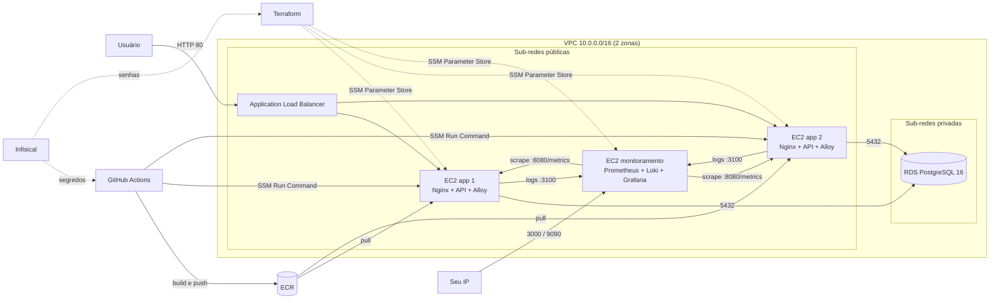

# TennisLog

Aplicação para registrar partidas e treinos de tênis (CRUD), implantada na AWS com
infraestrutura como código, pipeline CI/CD, segredos no Infisical e observabilidade.
Projeto Integrador de Computação em Nuvem.

- **Backend:** API REST em ASP.NET Core 8 (C#), EF Core e PostgreSQL, com Swagger, `/health` e `/metrics`.
- **Frontend:** página HTML/JS servida pelo Nginx, que também faz o proxy de `/api/*` para a API.
- **Infraestrutura:** Terraform (VPC, ALB, 2 EC2, RDS, ECR, monitoramento), state remoto no S3.
- **CI/CD:** GitHub Actions (lint, testes, build, push no ECR, deploy via SSM e verificação).
- **Segredos:** Infisical (aplicação local, Terraform e pipeline).
- **Observabilidade:** Prometheus, Loki, Grafana e Grafana Alloy.

Documentos: [proposta](docs/proposta.md) · [decisões técnicas](docs/decisoes-tecnicas.md) ·
[segurança](docs/seguranca.md) · [andamento e evidências](docs/andamento.md)

## Arquitetura



Security groups em cadeia: internet → ALB (80) → instâncias (80) → RDS (5432). A porta
8080 das instâncias só aceita o monitoramento; Grafana e Prometheus só aceitam o seu IP.

## Estrutura

| Pasta | Conteúdo |
|---|---|
| `app/backend/` | API (`TennisLog.Api`), testes xUnit (`TennisLog.Tests`) e Dockerfile |
| `app/frontend/` | `index.html`, configuração do Nginx e Dockerfile |
| `app/docker-compose.yml` | Stack local: PostgreSQL + API + frontend |
| `infra/` | Terraform; `bootstrap/` cria o bucket do state e sincroniza as credenciais do lab |
| `.github/workflows/` | `ci.yml`, `deploy.yml` e `infisical-check.yml` |
| `observability/` | Prometheus, Grafana (datasources e dashboard como código) e Alloy |
| `ansible/` | Não usado: a configuração é feita por `user_data` e SSM (ver decisões técnicas) |
| `docs/` | Proposta, decisões técnicas, segurança e andamento |

## Pré-requisitos

Docker, [Infisical CLI](https://infisical.com/docs/cli/overview), Terraform ≥ 1.10, AWS CLI v2
e GitHub CLI (`gh`). No macOS:

```bash
brew install infisical/get-cli/infisical hashicorp/tap/terraform awscli gh
infisical login        # Infisical Cloud (US); o .infisical.yaml já aponta para o projeto
```

### Segredos no Infisical

| Ambiente / pasta | Segredo | Usado por |
|---|---|---|
| `dev` `/` | `POSTGRES_USER`, `POSTGRES_PASSWORD`, `POSTGRES_DB` | Compose local |
| `prod` `/` | `POSTGRES_PASSWORD` (só letras e números) | Terraform → RDS |
| `prod` `/` | `GF_SECURITY_ADMIN_PASSWORD` | Terraform → Grafana |
| `prod` `/ci` | `TF_VAR_infisical_client_id`, `TF_VAR_infisical_client_secret` | Terraform local |
| `prod` `/ci` | `AWS_ACCESS_KEY_ID`, `AWS_SECRET_ACCESS_KEY`, `AWS_SESSION_TOKEN` | Terraform local e pipeline (atualizados a cada sessão por `lab-creds.sh`) |

No GitHub (**Settings → Secrets and variables → Actions**) ficam só `INFISICAL_CLIENT_ID` e
`INFISICAL_CLIENT_SECRET`, da machine identity (Universal Auth, papel Viewer).

## Rodar localmente

```bash
cd app
infisical run --env=dev -- docker compose up --build
```

| Endereço | O quê |
|---|---|
| http://localhost:3080 | Frontend |
| http://localhost:8088/swagger | Swagger da API |
| http://localhost:8088/health · `/metrics` | Health check e métricas |

Sem Infisical: `cp .env.example .env` e `docker compose up --build`.

Testes: `cd app/backend && dotnet test TennisLog.Tests` (usam banco em memória).

## Implantar na AWS (Learner Lab)

**Uma vez por conta do lab**, com as credenciais já em `~/.aws/credentials` (passo 1 abaixo),
crie o bucket do state (o Terraform não consegue gerenciar buckets no Learner Lab):

```bash
bash infra/bootstrap/bootstrap.sh            # cria o bucket e gera infra/backend.hcl
cp infra/terraform.tfvars.example infra/terraform.tfvars
# edite: infisical_workspace_id e admin_cidr (seu IP: curl -s https://checkip.amazonaws.com)
```

**A cada sessão do lab:**

```bash
# 1. Inicie o lab, abra "AWS Details > AWS CLI" e cole o bloco em ~/.aws/credentials
bash infra/bootstrap/lab-creds.sh            # copia as credenciais para o Infisical (prod:/ci)

# 2. Infraestrutura
cd infra
infisical run --env=prod --path=/ci -- terraform init -backend-config=backend.hcl
infisical run --env=prod --path=/ci -- terraform apply

# 3. Build, push e deploy pelo pipeline
gh workflow run deploy.yml && gh run watch    # ou: Actions > deploy > Run workflow

# 4. Acessar
terraform output app_url        # aplicação
terraform output grafana_url    # Grafana: usuário admin, senha GF_SECURITY_ADMIN_PASSWORD
terraform output prometheus_url # Prometheus: Status > Targets

# 5. Ao terminar: DESTRUIR (ALB, RDS e EC2 consomem o orçamento do lab)
infisical run --env=prod --path=/ci -- terraform destroy
```

Deploy manual, sem o pipeline (a partir de `infra/`):

```bash
REGISTRY=$(terraform output -raw ecr_registry)
aws ecr get-login-password | docker login --username AWS --password-stdin "$REGISTRY"
for svc in backend frontend; do
  docker build --platform linux/amd64 -t "$REGISTRY/tennislog-$svc:latest" "../app/$svc"
  docker push "$REGISTRY/tennislog-$svc:latest"
done
eval "$(terraform output -raw deploy_command)"
```

Fim do projeto: `terraform destroy` e depois `bash infra/bootstrap/bootstrap.sh destroy`.

## CI/CD

| Workflow | Quando | O que faz |
|---|---|---|
| `ci.yml` | Pull request e push em outras branches | `dotnet format --verify-no-changes`, `dotnet test`, `terraform fmt -check` e `terraform validate` |
| `deploy.yml` | Push na `main` e manual | Roda o `ci.yml`; se passar: lê as credenciais no Infisical, build das duas imagens, push no ECR (tag = SHA do commit e `latest`), deploy via SSM em uma instância por vez e `curl` em `/api/health` pelo ALB |
| `infisical-check.yml` | Manual | Lê `POSTGRES_PASSWORD` do Infisical e mostra que o valor sai mascarado (`***`) no log |

Se um teste falhar, o job `ci` fica vermelho e o `deploy` não roda. Cada instância só
reporta sucesso depois de responder `Healthy`, então uma versão quebrada interrompe o
deploy antes de atingir a segunda instância.

## Observabilidade

Uma terceira instância (`t3.small`) roda `observability/docker-compose.yml`:

- **Prometheus** raspa `/metrics` (prometheus-net) das duas instâncias pela porta 8080.
- **Alloy**, em cada instância de aplicação, lê os logs dos containers (JSON) e envia ao **Loki**.
- **Grafana** sobe com os datasources e o dashboard **TennisLog** já provisionados:
  disponibilidade (`up`), requisições por segundo, latência p95, taxa de erros 5xx,
  requisições por rota e logs.

Para ver os gráficos se moverem, gere tráfego:

```bash
URL=$(terraform -chdir=infra output -raw app_url)
for i in $(seq 1 300); do curl -s -o /dev/null "$URL/api/matches"; curl -s -o /dev/null "$URL/api/matches/999"; done
```

## Problemas comuns

| Sintoma | Causa e solução |
|---|---|
| `ExpiredToken` / `InvalidClientTokenId` | Credenciais do lab vencidas: copie as novas para `~/.aws/credentials` e rode `lab-creds.sh` |
| Pipeline falha em "Check AWS credentials" | Mesmo caso: o Infisical ainda tem as credenciais da sessão anterior |
| Alvos `unhealthy` no ALB logo após o `apply` | As imagens ainda não estão no ECR: rode o pipeline (ou o deploy manual) |
| Grafana sem logs | O Alloy sobe no deploy; rode o deploy de novo depois que a instância de monitoramento existir |
| Grafana não abre | Seu IP mudou: atualize `admin_cidr` no `terraform.tfvars` e rode `apply` |
| `exec format error` nas instâncias | Imagem construída em Mac ARM sem `--platform linux/amd64` |
| `terraform init` pede o bucket | Falta o `infra/backend.hcl`: rode `bootstrap.sh` |

Nunca clique em **Reset** no Learner Lab: isso apaga o bucket do state.

## Divisão de tarefas

| Integrante | Responsabilidades |
|---|---|
| _(nome)_ | _(preencher)_ |
| _(nome)_ | _(preencher)_ |
