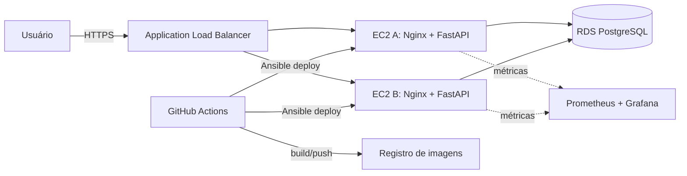

# Proposta Inicial: TennisLog (Fase 0)

## 1. Problema e aplicação
Jogadores e treinadores amadores registram partidas e treinos em planilhas ou
mensagens, sem histórico consultável. O **TennisLog** é uma aplicação simples
para cadastrar, listar, editar e remover partidas (CRUD), com campos como data,
adversário, placar, superfície e observações.

**Escopo (pequeno e fechado):**
- Frontend: página única (lista + formulário).
- Backend: API REST (`/matches`, `/health`, `/metrics`).
- Banco: PostgreSQL com a tabela `matches`.

**Fora do escopo:** autenticação social, estatísticas avançadas, app mobile.

## 2. Arquitetura preliminar

Rede: VPC com sub-redes públicas (ALB) e privadas (RDS); instâncias em
duas zonas de disponibilidade.

## 3. Tecnologias e justificativas

| Tecnologia | Papel | Segurança | Escalabilidade | Manutenção | Disponibilidade |
|---|---|---|---|---|---|
| FastAPI (Python) | Backend | Validação com Pydantic | Stateless, escala horizontal | Código curto, OpenAPI automática | Endpoint `/health` |
| HTML/JS + Nginx | Frontend | Cabeçalhos de segurança, TLS | Estático, fácil de cachear | Sem build complexo | Servido em múltiplas instâncias |
| PostgreSQL (RDS) | Banco | Sub-rede privada, criptografia em repouso | Réplicas de leitura | Backups e patches gerenciados | Multi-AZ |
| Docker | Empacotamento | Imagem mínima, sem root | Réplicas idênticas | Ambiente reproduzível | Rollback por tag |
| Terraform | Infra como código | Segredos fora do código | Replicação de ambientes | Versionado no Git | Recriação previsível |
| Ansible | Configuração/deploy | Chaves SSH, Vault | Aplica em N hosts | Playbooks idempotentes | Deploy rolling |
| GitHub Actions | CI/CD | Secrets do repositório | Pipeline por PR | Testes e lint automáticos | Deploy automatizado |
| Prometheus + Grafana | Observabilidade | Acesso restrito | Coleta por scrape | Dashboards versionados | Alertas de indisponibilidade |
| ALB | Entrada | TLS, security groups | Distribui carga | Gerenciado | Health checks |

## 4. Repositório
Estrutura criada: `app/`, `infra/`, `.github/workflows/`, `ansible/`,
`observability/`, `docs/`. Ver `README.md`.

## 5. Próximas fases (previsão)
Fase 1: app + Docker; Fase 2: infra (Terraform); Fase 3: CI/CD e Ansible;
Fase 4: observabilidade.
